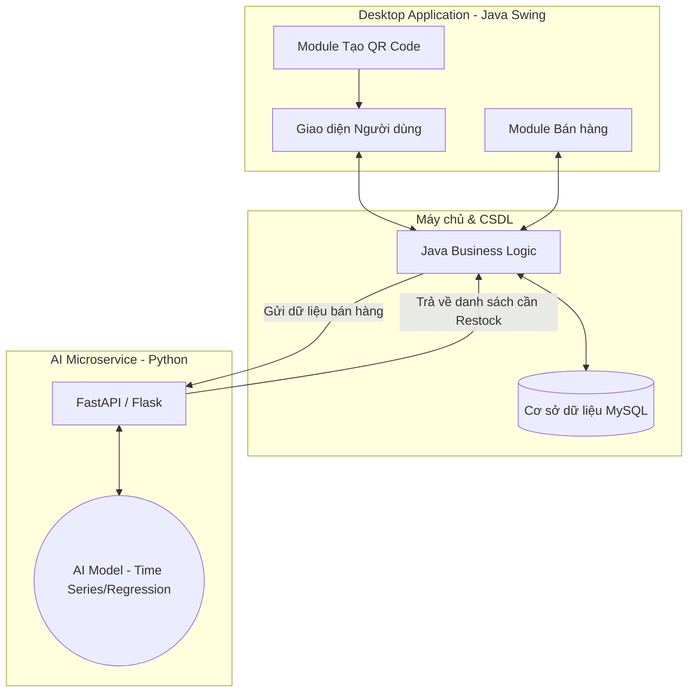
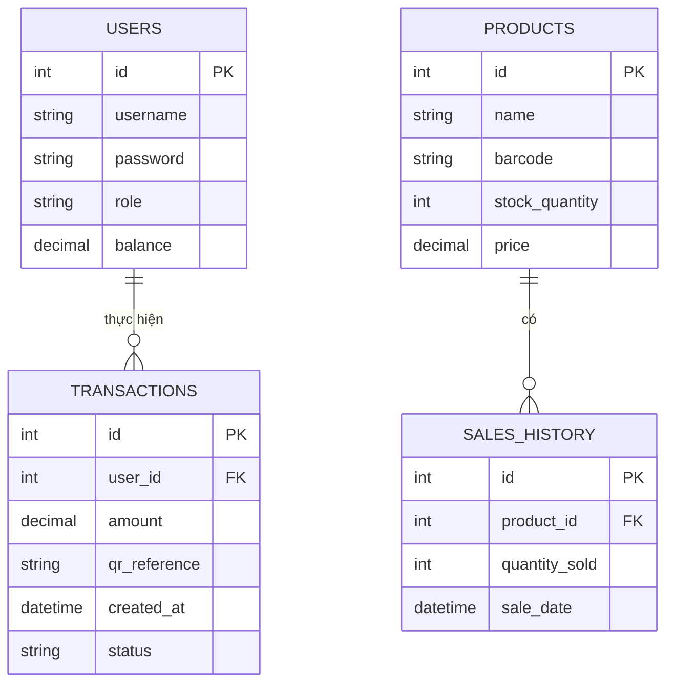

# 🏦 Hệ thống Quản lý Giao dịch & Bán lẻ Thông minh (Smart Merchant & Bank POS)

Hệ thống ứng dụng Desktop được xây dựng bằng **Java Swing**, tích hợp các tính năng thanh toán hiện đại (Tạo mã QR) và ứng dụng Trí tuệ nhân tạo (AI) để tối ưu hóa chuỗi cung ứng cho các siêu thị và điểm bán lẻ.

---

## 🌟 Tính năng chính

### 1. Quản lý Giao dịch & Thanh toán (Banking/Payment Module)
*   **Quản lý tài khoản:** Quản lý số dư, lịch sử giao dịch của khách hàng/đại lý.
*   **Tạo QR Code chuyển tiền:** Tự động tạo mã QR (theo chuẩn VietQR hoặc chuẩn nội bộ) chứa thông tin đơn hàng, số tiền và nội dung chuyển khoản để khách hàng quét và thanh toán nhanh chóng.
*   **Báo cáo tài chính:** Thống kê doanh thu, luồng tiền vào/ra trong ngày, tháng.

### 2. Quản lý Siêu thị & Kho hàng (Retail & Inventory Module)
*   **Quản lý sản phẩm:** Thêm, sửa, xóa thông tin hàng hóa, giá cả, số lượng tồn kho.
*   **Xử lý đơn hàng:** Quét mã vạch, tính tiền và in hóa đơn (POS).

### 3. Tích hợp Trí tuệ nhân tạo (AI Module)
*   **Dự đoán nhập hàng (Restock Prediction):** Dựa trên lịch sử bán hàng, xu hướng thời gian (mùa vụ, ngày lễ), AI sẽ phân tích và dự đoán những sản phẩm sắp hết hoặc có nhu cầu cao để tự động cảnh báo nhập hàng (Restock).

---

## 🛠 Công nghệ sử dụng

*   **Frontend (Giao diện người dùng):** Java / Java Swing (FlatLaf để giao diện hiện đại hơn).
*   **Backend / Logic:** Java (Core).
*   **Cơ sở dữ liệu:** MySQL hoặc PostgreSQL.
*   **Tạo QR Code:** Thư viện ZXing (Zebra Crossing) cho Java.
*   **AI & Machine Learning:** Python (FastAPI/Flask) kết hợp Scikit-Learn/TensorFlow. (Ứng dụng Java sẽ gọi API sang hệ thống Python để lấy kết quả dự đoán nhằm đảm bảo hiệu năng tốt nhất).

---

## 📐 Kiến trúc Hệ thống (System Architecture)

*Sơ đồ dưới đây mô tả cách các thành phần trong hệ thống giao tiếp với nhau.*

---

## 🗄️ Cấu trúc Cơ sở dữ liệu (Database Entity Relationship)

*Sơ đồ thực thể liên kết (ERD) cơ bản cho hệ thống.*

---

## 🚀 Luồng hoạt động chính (Workflows)

### 1. Luồng Thanh toán bằng QR Code
1. Nhân viên tính tiền các sản phẩm trên Java Swing.
2. Hệ thống tổng hợp số tiền và gọi thư viện **ZXing**.
3. Hình ảnh QR Code được render ngay trên màn hình (JFrame/JPanel).
4. Khách hàng dùng app ngân hàng quét mã để thanh toán.
5. (Tùy chọn) Ứng dụng gọi API webhook của ngân hàng để xác nhận giao dịch thành công và in hóa đơn.

### 2. Luồng Dự đoán AI (Restock)
1. Mỗi cuối ngày, hệ thống Java trích xuất dữ liệu từ bảng `SALES_HISTORY`.
2. Dữ liệu được đóng gói thành JSON và gửi qua HTTP POST request đến **AI Microservice (Python)**.
3. Model AI (ví dụ: ARIMA, Random Forest) phân tích dữ liệu bán hàng 30 ngày qua.
4. Python API trả về danh sách các `product_id` có khả năng cạn kho trong 3 ngày tới kèm theo số lượng cần nhập.
5. Java Swing hiển thị "Bảng cảnh báo nhập hàng" trên màn hình quản lý.

---

## ⚙️ Hướng dẫn Cài đặt & Chạy dự án (Dự kiến)

1. Cài đặt **Java JDK 17+** và **Maven**.
2. Cài đặt CSDL **MySQL**, import file `database.sql`.
3. Cấu hình file `application.properties` (hoặc `.env` trong Java) để kết nối CSDL.
4. Chạy service AI: `python app.py` (tại thư mục `/ai-service`).
5. Build và chạy file `.jar` hoặc chạy trực tiếp class `Main.java` qua IDE (IntelliJ/Eclipse).