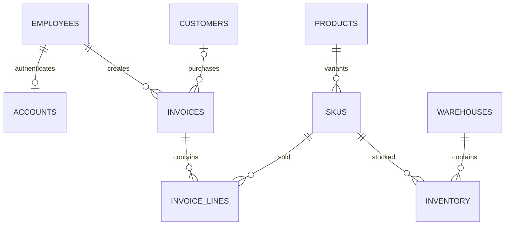

# Supermarket architecture and assignment coverage

The implemented feature is **Đăng nhập**. This project now uses the requested stack: Vue 3, Spring Boot REST, Spring Security JWT, Spring Data JPA/Hibernate and PostgreSQL. Inventory and invoice entities establish the database foundation; they do not constitute a completed checkout or administration application.

## Relational model

Employee identity is separate from authentication credentials. Products hold shared descriptive information; each SKU holds its variant, unit, code and price. Inventory is an association between a warehouse and a SKU, with one row per pair. Invoice lines separate repeating sale items from invoice headers. Their price is a historical sale price, not a duplicated current SKU price. Invoice totals are derived from quantities and historical prices. Customer is optional for walk-in sales. Foreign keys, uniqueness, nonnegative prices/stock and positive sale quantities are enforced in SQL.

Flyway migration `backend/src/main/resources/db/migration/V1__supermarket.sql` is the source of database structure. Hibernate validates it at startup rather than altering production tables. Do not edit applied migrations; add V2 and later migrations. Every core table has a matching JPA entity.

## Login and authorization

1. Vue submits JSON `{accountName, password}` to `POST /api/auth/login`.
2. Spring Security authenticates using the JPA `AccountRepository.findByAccountName` lookup and BCrypt comparison. Hibernate binds the account name as a SQL parameter. Disabled and unknown accounts produce the same public authentication error.
3. The server returns a signed HS256 JWT containing subject, issuer, expiry, unique token ID, account version and role. Tokens last 15 minutes.
4. Protected requests send `Authorization: Bearer <token>`. The resource server validates signature, issuer and timestamps. The additional validator checks current account state, version, role and logout revocation in PostgreSQL.
5. Logout records the token ID until expiry. A scheduled task removes expired revocations. Concurrent requests already in progress may finish when logout occurs.

The frontend keeps the JWT only in memory. Reloading or closing the page requires signing in again. There is no refresh-token flow. CSRF protection is disabled because authentication never uses ambient cookies; clients must explicitly supply bearer tokens. No cross-origin access is enabled: use Vite's development proxy or serve the built frontend through Spring Boot.

| API area | STAFF | MANAGER | ADMIN |
| --- | --- | --- | --- |
| `/api/auth/me`, `/api/auth/logout` | Yes | Yes | Yes |
| `/api/pos/**` | Yes | Yes | Yes |
| `/api/management/**` | No | Yes | Yes |
| `/api/admin/**` | No | No | Yes |

The last three are authorization policies for future modules, not existing business endpoints. Tests install temporary probe controllers to verify the policies. Updating an account through JPA increments its version and invalidates old tokens, including after password changes. Direct SQL changes must increment `accounts.version` when changing passwords.

## Concurrent stock updates

`InventoryService.decreaseStock` runs inside a transaction, verifies available quantity and updates a versioned inventory entity. Hibernate includes the previous version in the update; competing writes cannot silently overwrite one another. A conflict aborts the transaction, and a database CHECK prevents negative stock. An integration test makes two transactions read the same version and asserts that only one succeeds.

This is a reusable stock primitive. A future checkout service must wrap invoice writes and all stock changes in a single transaction, translate optimistic conflicts to HTTP 409, and let the cashier retry against fresh stock. Do not automatically retry payment requests.

## Implemented business & AI modules (V2–V4)

- **Account & password workflows** (`modules/account`, `V4__password_requests.sql`):
  - `POST /api/auth/change-password`: authenticated password change (increments `accounts.version` and invalidates prior JWTs).
  - `POST /api/auth/password-requests`: public forgot-password request by submitting personal employee details.
  - `GET /api/management/password-requests`, `POST /api/management/password-requests/{id}/approve|reject`: `MANAGER` handles `STAFF` requests; `ADMIN` handles all roles.
  - `GET/POST /api/management/accounts`, `PUT /api/management/accounts/{id}/enabled`: `MANAGER` creates/manages `STAFF` accounts; `ADMIN` manages `STAFF`, `MANAGER` and `ADMIN`.
- **Catalog & stock** (`modules/catalog`, `modules/stock`, `V2__catalog_stock.sql`):
  - Categories, products, SKUs (barcode + variant + unit price), suppliers, warehouses, inventory thresholds and atomic stock import receipts (`import_receipts`, `import_lines`).
- **POS & payments** (`modules/pos`, `V3__pos_payment.sql`):
  - Barcode lookup (`GET /api/pos/skus/by-code/{code}`), draft invoice creation (`POST /api/pos/invoices`), and transactional payment completion (`POST /api/pos/invoices/{id}/pay`) supporting **CASH** and **TRANSFER** (VietQR image URL with prefilled amount and transfer reference).
- **Reporting, forecasting & AI** (`modules/report`, `modules/ai`):
  - 14-day revenue summary, top-selling SKUs, co-purchase recommendations (`GET /api/pos/recommendations`), and 4-week Weighted Moving Average 7-day demand forecasting (`GET /api/management/reports/forecast`).
  - `POST /api/pos/ai/recognize-product`: Gemini Vision product recognition from camera/photo when a barcode is unreadable.
  - `POST /api/management/ai/chat`: natural-language business assistant grounded strictly on `ReportService` snapshots (with automatic local analytics fallback when `GEMINI_API_KEY` is not set).

## References

- [Spring Security JWT resource server](https://docs.spring.io/spring-security/reference/servlet/oauth2/resource-server/jwt.html)
- [Vue application setup](https://vuejs.org/guide/quick-start)
